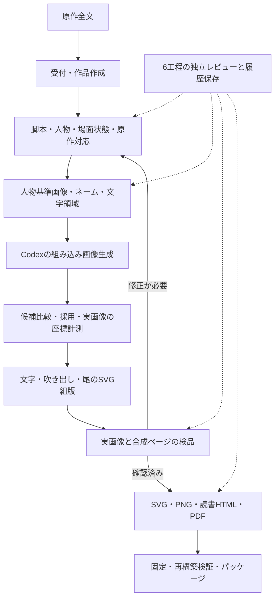

# 漫画制作の仕組みと背景論文

調査日：2026年10月8日。現在の共通実装、制作手順、保存済みの調査記録と、外部の一次資料を照合した整理。

このrepoは、Codexが原作の読解・脚本化・画像生成・画像を見た検品と修正を担い、Node.jsのCLIが構造化データ・生成指示・組版・検査・履歴・再現パッケージを管理する制作環境である。研究モデルを学習・推論する専用サーバーをこのrepo内で実装しているわけではない。

## 1. 全体の流れ

`cli/auto.mjs start` は受付・再開とCodexへの実行依頼を作成する。画像生成はCodexが実際にツールを呼ぶ工程であり、受付コマンドだけでは作画は完了しない。

## 2. 仕組みの一覧

| 仕組み | 実際に行うこと | 主な実装・保存先 | 背景との関係 |
| --- | --- | --- | --- |
| 作品の独立管理 | 新作は別ディレクトリへ作成。`MANGA_PROJECT`で対象を選択。同じ原作の自動受付は再開する | `cli/new-work.mjs`、`src/project.mjs`、`cli/auto.mjs`、`works/<ID>/` | repoの運用設計 |
| 原作からの脚本化 | ページの狙い・次への期待、コマの役割・動作・表情・画角・セリフをCodexが設計 | 各作品の`workflow.json` | P1の工程分離、P4・P6の物語とネームの考え方 |
| 原作全体の対応表 | 本文の連続した区間をコマと漫画化方法へ対応付け、区間の欠落・重複を検査 | `cli/auto.mjs`、`workflow/source-coverage.json` | repoの検証設計。文字範囲の網羅だけでは意味の忠実性を証明しない |
| 人物と場面状態の分離 | 恒常的な外見は`cast`、舞台・衣装・小道具は`sections`、コマ固有の違いは`panel.state`へ保存 | `cli/workflow.mjs`の`stateFor`、`story-memory.json` | P1のsection memory、P2の人物同一性と演技の両立 |
| 顔の基準と参照役割 | 顔の3特徴、角度・表情の基準画像、顔・線・構図・衣装などの参照用途を明示 | `src/face-design.mjs`、`cast.faceDesign`、`referenceRoles` | P2と公式画像生成ガイドを制作手順へ応用。3特徴という数はrepo独自 |
| ネームと文字領域の先行設計 | 作画前にコマ・顔・口・吹き出しの領域を設定。番号あり・番号なし・コマ単位の参照を出力 | `cli/workflow.mjs plan`、`storyboards/`、`storyboards-unnumbered/`、`panels/` | P1・P9の制御課題、P4・P5の絵と文字の統合 |
| 読順・場面接続の計画 | 会話群、魅せゴマ、面積比、情報公開、ページ末の問い、全隣接コマの時刻・場所・小道具・左右変化を台帳化 | `src/reading-flow.mjs`、`reading-flow/`、`narrative-plan.json` | P4〜P8。台帳のスキーマと警告アルゴリズムはrepo独自 |
| コマ単位の画像生成 | 標準は`renderMode: panels`。基準画像とネームを使い、文字・吹き出しなしのコマを生成 | `panel-jobs.json`、Codexの組み込み`image_gen` | P1の工程分離、P2・P9の課題設定を応用。各研究モデルは未導入 |
| 生成・編集の証跡 | 実際の指示、参照画像の不変コピー、ハッシュ、出力画像、生成手段を保存 | `cli/generation.mjs`、`generation-inputs/`、`generation-history/`、`generation-log.json` | repoの証跡設計。準備・記録CLI自体は画像生成を実行しない |
| 候補比較と採用 | コマ候補の比較HTMLを作り、理由を付けて採用。古い指示の候補は採用時に拒否 | `cli/workflow.mjs candidate-panel / accept-panel`、`assets/candidates/` | repoの選択・履歴設計 |
| 実画像に合わせた位置計測 | 見えている全顔・口・重要な手や小道具を登録し、画像差し替え後に再測定 | `speakers.anchor`、`speakers.face`、`protected` | P5の人物と吹き出しの統合配置を実務へ応用。座標は自動認識しない |
| 日本語の別組版 | セリフを右から左の縦列へ分け、吹き出し・尾・枠をSVGで重ねる。`textColumns`で意味単位の列を指定できる | `cli/workflow.mjs`の`columns / speechColumns / box / tailGeometry / svg` | repoの組版実装と日本語漫画の制作ガイド |
| 幾何検査と自動配置 | 枠外・吹き出し同士の重なり・顔や保護領域の遮蔽・尾の交差・粗い読順違反を拒否。候補位置を探索する | `cli/workflow.mjs validate / layout` | P5の問題意識に対応。論文の確率モデルの実装ではない |
| 描画の倍率別検品 | 縮小・100%・200%と合成を見て、人体・接触・物・顔・線・背景・連続性・文字の8項目と全顔の特徴を記録 | `src/quality.mjs`、`src/face-design.mjs`、`quality-plan / quality-review / quality-repair` | P3のアーティファクト研究を漫画の検品へ応用。検品項目・倍率・判定ゲートはrepo独自 |
| 工程ごとの独立レビュー | 原作・脚本・ネーム・実画像・文字合成・最終原稿の6工程をサブエージェントが確認。未解決指摘・古い入力・読順不一致を拒否 | `cli/stage-review.mjs`、`src/stage-reviews.mjs` | repoの工程設計。論文で実証済みの品質保証として扱わない |
| 変更時の失効 | 指示・参照・素材・配置などのハッシュを確認し、古い採用記録・検品・レビューを使わせない | `cli/workflow.mjs`、`src/quality.mjs`、`src/stage-reviews.mjs` | repoの検証設計。変更の影響範囲に応じて失効する |
| 状態履歴と復元 | 実行前後や失敗途中の状態を保存。内容ハッシュ別に画像を保持し、新しいフォルダへ復元 | `src/state-history.mjs`、`cli/history.mjs`、`.manga-history/` | repoの保存設計 |
| 完成出力と再現 | 絵と文字を分離したレイヤー、読書HTML・PNG・PDFを作成。採用済み入力を固定してSVG・HTMLの同一性を検証 | `cli/workflow.mjs`、`cli/export.mjs`、`cli/pdf.mjs`、`export-pdf.py`、`cli/reproduce.mjs`、`src/archive.mjs` | repoの成果物・再現設計 |

## 3. 背景論文の一覧

以下の「反映」は、リポジトリに保存された設計判断との対応を指す。論文の学習モデル・実験条件・性能を再現したという意味ではない。

| ID | 論文・書誌 | 主な内容 | このrepoとの対応・採用の強さ |
| --- | --- | --- | --- |
| P1 | Muyao Wangほか（2026）, **MangaFlow: An End-to-End Agentic Framework for Controllable Story to Manga Generation**。[arXiv:2605.28173](https://arxiv.org/abs/2605.28173) | 計画、参照による接地、レイアウト、コマ描画、ページ合成、文字配置を分離。section memoryで人物・舞台・物の参照を再利用 | `docs/IMPROVEMENTS.md`で明示的に採用。コマ制作、`sections`、参照、別組版への主要な設計背景。MangaFlow本体の導入・ベンチマーク再現はしていない |
| P2 | Jianzong Wuほか（2024年プレプリント／CVPR 2025）, **DiffSensei: Bridging Multi-Modal LLMs and Diffusion Models for Customized Manga Generation**。[arXiv:2412.07589](https://arxiv.org/abs/2412.07589) | 拡散モデルとMLLMのidentity adapterを組み合わせ、人物の特徴を保ちつつコマごとの表情・姿勢・動作へ適応。複数人物の配置を制御 | `docs/IMPROVEMENTS.md`で明示的に参照。恒常特徴と場面状態を分ける設計の背景。masked cross-attention、adapter、MangaZero学習は未実装 |
| P3 | Negar Kamaliほか（CHI 2025）, **Characterizing Photorealism and Artifacts in Diffusion Model-Generated Images**。[arXiv:2502.11989](https://arxiv.org/abs/2502.11989) | 生成写真と実写真を用いた人の識別実験と、不自然な構造などのアーティファクト分類。場面の複雑さや選別などの影響を分析 | `docs/ART-QUALITY.md`で明示的に採用。人体・接触・物の整合性、候補選別と修正の工程へ応用。写真の研究であり、白黒漫画の改善率を実証したものではない |
| P4 | Hiroaki Tanaka・Takashi Iba（PLoP 2024）, **Fundamental Patterns for Crafting Engaging Manga**。[著者公開PDF](https://web.sfc.keio.ac.jp/~iba/papers/PLoP2024_MangaPatterns.pdf) | 漫画の実践知を10の基本パターンへ整理。クライマックスへの構築、魅せゴマ、吹き出しによる誘導、全体からネームへの反復など | `docs/NARRATIVE-FLOW.md`と調査記録で明示的に採用。ページの感情・魅せゴマ・反応・会話群の設計へ反映。読者実験による万能配置規則ではない |
| P5 | Ying Cao・Rynson W. H. Lau・Antoni B. Chan（ACM TOG 33(4), SIGGRAPH 2014）, **Look Over Here: Attention-Directing Composition of Manga Elements**。[著者公開ページ](https://www.ying-cao.com/projects/manga_composition/manga_composition.htm) | 人物、吹き出し、作者の誘導経路と読者の注意の関係を確率グラフィカルモデルで扱う配置手法 | `docs/NARRATIVE-FLOW.md`で明示的に採用。顔・演技・文字領域を一緒に計画する背景。現在の矩形距離・交差検査・探索配置は独自実装であり、論文モデルや眼球運動計測は未導入 |
| P6 | Neil Cohn（Frontiers in Psychology 5:680, 2014）, **The architecture of visual narrative comprehension: the interaction of narrative structure and page layout in understanding comics**。[論文](https://pmc.ncbi.nlm.nih.gov/articles/PMC4076615/) | 物語構造、ページ配置、コマが切り取る情報が並行して働き、漫画理解を成立させるという枠組み | 保存済みのユーザー提供調査資料で参照。情報・役割・配置を別の観点から検討する理論背景として対応する。共通コードへの直接の採用記録はP4・P5・P7・P8ほど明示的でなく、対応の一部は本整理の解釈 |
| P7 | Neil Cohn・Fred Atilla・Lenneke Lichtenberg・Bruno Cardoso（Cognition 260:106136, 2025）, **The influence of writing systems on comics layouts**。[著者抄録・書誌](https://pubmed.ncbi.nlm.nih.gov/40179483/) | 国際コーパスで文字体系と漫画の配置を分析。日本漫画では右→左・下方向の経路や縦列の傾向が見られ、文字方向だけでは説明しきれない | `docs/NARRATIVE-FLOW.md`で明示的に採用。日本語の基本方向を使いつつ、すべてを固定S字へそろえない根拠。吹き出し距離のしきい値を導いた研究ではない |
| P8 | Tom Foulsham・Neil Cohn（Journal of Experimental Psychology: Learning, Memory, and Cognition, 2026年9月3日オンライン先行公開）, **On the interaction between layout and narrative in the processing of comic strips**。[著者抄録・書誌](https://pubmed.ncbi.nlm.nih.gov/42691285/) | 同じ漫画を異なる配置で提示した2実験。段の改行で以前のコマへの視線回帰が減り、物語境界と改行の一致も回帰に関係 | `docs/NARRATIVE-FLOW.md`で明示的に採用。会話や場面のまとまりと段・ページの境界を検討する背景。日本語吹き出しの具体距離や、このrepoの効果を実証した研究ではない |

旧版の背景として、別に次の1本が保存されている。上の8本と合わせて、今回確認した背景・関連論文は9本である。

| 論文 | 内容と対応 |
| --- | --- |
| P9：Siyu Chenほか（2024）, **Manga Generation via Layout-controllable Diffusion**。[arXiv:2412.19303](https://arxiv.org/abs/2412.19303) | `docs/history/README-history.md`の初期調査資料。Manga109StoryとMangaDiffusionを提案し、文章と各コマの意味対応、レイアウト、人物一貫性などを扱う。repoではこれらを別の制御課題として扱う背景に位置付けられるが、モデル・データセットは導入していない |

## 4. 論文以外の背景資料

| 資料 | repoでの使い方 |
| --- | --- |
| [OpenAI Image prompting](https://developers.openai.com/api/docs/guides/image-prompting)／[画像生成のプロンプト例](https://developers.openai.com/cookbook/examples/multimodal/image-gen-1.5-prompting_guide) | 具体的な形・描画方法・構図の指定、入力画像の役割分け、編集で維持する特徴の明示。`docs/FACE-DESIGN.md`に採用根拠がある。例示されたモデル名は、このrepoで実際に使ったモデルIDの証拠にはならない |
| [小学館提供の吹き出し講座](https://www.clipstudio.net/oekaki/archives/152081) | 右から左の読順、話者に近い配置、文節での改行、長台詞の分割。保存済み調査記録に閲読範囲がある |
| [MediBangの読みやすい漫画の講座](https://medibangpaint.com/use/2021/06/7-tips-for-drawing-easy-to-read-manga/) | 非連続吹き出しの先読み、段差・間隔、引きと寄り、場面転換を検討する実践資料 |
| [CLIP STUDIOの制作ガイド](https://www.clipstudio.net/en/comics-manga/comic-creation/)／[演出ガイド](https://www.clipstudio.net/en/comics-manga/design-tips/) | ラフ段階の文字スペース、場所・時間の導入、背景省略、予備動作・動作・反応、ページの入口・出口 |
| [SORAJIMAの空間・軸の教材](https://tatelab.sorajima.jp/textbook/OJW33d9m) | 人物の位置関係と逆角度・移動時の視点の再導入。Webtoonの数値をページ漫画へ一律移植しない |
| ユーザー指定と実作品での指摘 | 同サイズ2コマへの固定を避ける、番号なしで先に読む、全隣接コマの接続を確認する、各工程に実際の独立レビューを挟む、旧素材の再採用と新規生成を区別する、などの制作条件 |

この節の制作教材の詳細は保存済み調査記録に基づく。今回、外部で新たに照合した範囲は論文の書誌・公開抄録、Tanaka・Iba論文の読める導入・方法・結果、OpenAI公式資料である。各論文の実験を再実行したわけではない。DiffSenseiの既存CVFリンクは取得時403だったため、同論文のarXiv版で照合した。

## 5. 研究と実装の境界

- **画像生成モデルは外部の組み込みツールを利用する。** このrepoにはDiffSensei、MangaDiffusion、LoRA、ControlNetなどを学習・推論する処理は導入されていない。組み込みツールの内部方式・正確なモデルIDは推測しない。
- **機械検査は座標・記録・入力の鮮度を扱う。** 顔の自動同定、手指の画像認識採点、実読者の視線測定は行っていない。記録に観察があることと、その観察の正しさは別である。
- **読順の数値は独自の近似規則である。** 現在の非連続吹き出し警告は縦列の重なり、外縁距離、次の発話までの距離との比などで候補を拾う。`0.65`、`32px`、コマ幅の`14%`、従来の`80px`段差条件は、論文が検証した普遍的なしきい値ではない。
- **番号付き経路は作者の意図を表示する。** 自然な読順は番号なし画像を実読して検討し、ネーム・文字合成・最終原稿の`readingReview`へ残す。最終的な理解や面白さの保証にはならない。
- **顔の3特徴・8項目検品・6工程レビュー・ハッシュ失効はrepoの工程設計である。** 関連研究を参考にしているが、この組み合わせの効果を対照実験で確認した記録はない。
- **再現性の対象は採用済み画像からの組版である。** `freeze`で入力・出力を固定し、SVG・HTMLの同一ハッシュを照合する。新規AI画像の同一再生成は保証しない。PNGの再書き出しはフォントとブラウザなどに依存する。

Tanaka・Iba論文の文献数は「140件を選定し、その時点で58書籍から133知見を抽出」である。「140件すべてから抽出」とはしない。また、Kamali論文の写真識別結果を漫画の改善率へ転用しない。

## 6. 詳細を追うための入口

| 確認したいこと | repo内の資料 |
| --- | --- |
| 全体の使い方 | `README.md`、`REPRODUCE.md` |
| 原作だけからの自動制作 | `docs/AUTOMATIC.md`、`cli/auto.mjs` |
| 工程分離・場面状態の採用根拠 | `docs/IMPROVEMENTS.md` |
| 描画検品と写真研究の応用範囲 | `docs/ART-QUALITY.md` |
| 顔の特徴・参照役割・公式ガイド | `docs/FACE-DESIGN.md` |
| 読順・時間・感情・場面接続 | `docs/NARRATIVE-FLOW.md`、`src/reading-flow.mjs` |
| 一次資料の過去の閲読範囲・採用と留保 | `docs/_research-flow-review-20261006.json` |
| 研究資料と実装の対応監査 | `docs/_research-integration-audit-20261008.json` |
| ユーザー提供のネーム設計資料 | `research/user-name-design-20261008.txt`、`docs/research/user-name-design-20261006.txt` |
| 独立レビューと保存・復元 | `docs/REVISION-AND-REVIEWS.md`、`src/stage-reviews.mjs`、`src/state-history.mjs` |
| 初期設計の背景論文 | `docs/history/README-history.md` |

本整理は文書とコードの照合による調査であり、作品の再検品・画像生成・ロック更新は行っていない。
